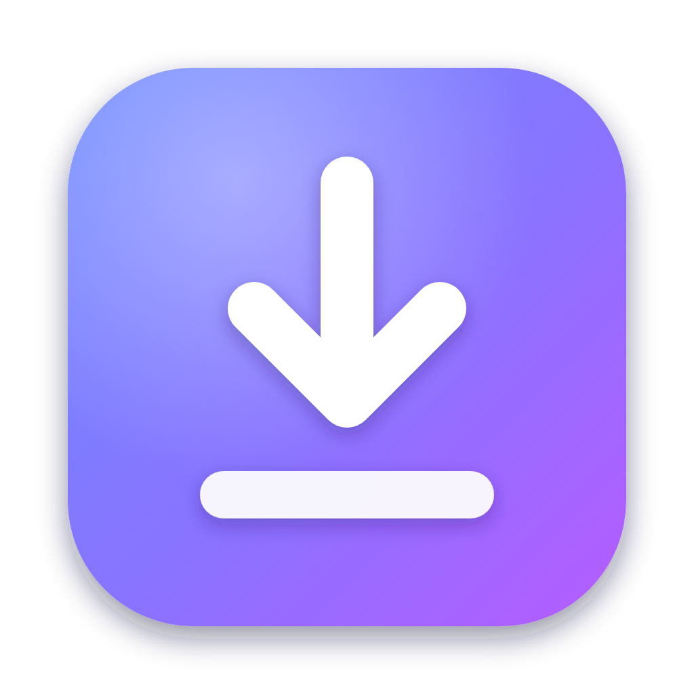
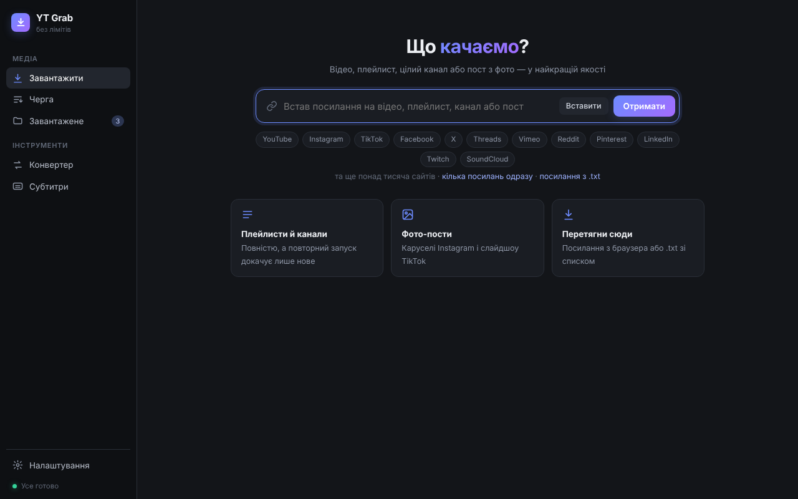
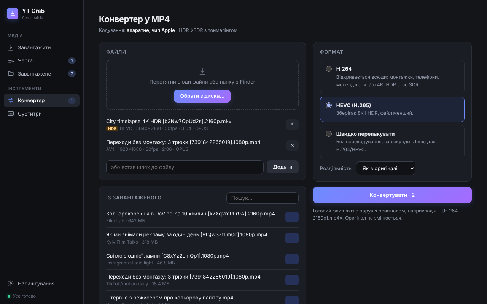
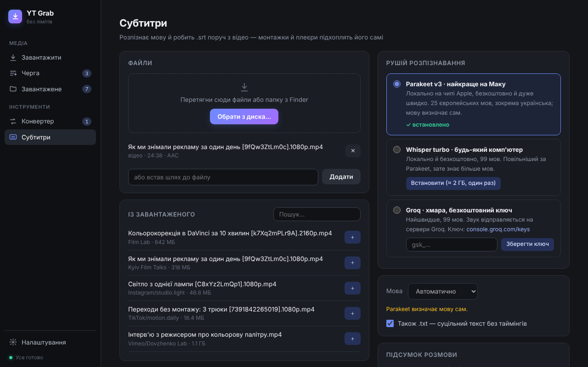

<p align="center">
  
</p>

<h1 align="center">YT Grab</h1>

<p align="center">
  Безкоштовний завантажувач відео для Mac — без лімітів і без реклами.<br>
  YouTube, Instagram, TikTok, Facebook, X, Vimeo та ще понад тисяча сайтів.
</p>

<p align="center">macOS 12+ · Apple Silicon і Intel · безкоштовно · <a href="https://slavashootit.github.io/yt-grab/">сайт</a></p>

## Встановити — обери один спосіб

**⚡ Одна команда в Терміналі** (без скачування файлів і без попереджень macOS).
Відкрий Термінал (⌘ + пробіл → «Термінал»), встав і натисни Enter:

```bash
curl -fsSL https://raw.githubusercontent.com/slavashootit/yt-grab/main/install.sh | bash
```

**⬇️ Або завантаж файл:** [YT-Grab.dmg](https://github.com/slavashootit/yt-grab/releases/latest/download/YT-Grab.dmg) — відкрий і перетягни YT Grab у «Програми»
(при першому запуску дозволь його в Системних параметрах, [покроково нижче](#варіант-2--файл-dmg)).

<p align="center">
  
</p>

## Що вміє

- **Відео в найкращій якості** — аж до 8K і HDR, будь-яку якість на вибір або лише звук у MP3 320 kbps.
- **Одразу в MP4** — качає в найкращій якості й сам перетворює в MP4 (H.264, а для 4K/8K і HDR — HEVC). Якщо відео вже H.264/HEVC — просто перепаковує без втрат.
- **Плейлисти й цілі канали** — повторний запуск докачує тільки нові відео.
- **Фото-пости** — каруселі Instagram і слайдшоу TikTok разом з музикою.
- **Кілька посилань одразу** — вставити списком, перетягнути з браузера або з `.txt`.
- **Конвертер у MP4** — H.264 для будь-яких програм, HEVC для 4K/8K і HDR, або швидке перепакування без втрат.
- **Субтитри з відео (Video → SRT)** — локально й безкоштовно через NVIDIA Parakeet або Whisper, чи через Groq у хмарі. Українська, англійська та десятки інших мов.
- **Підсумок розмови** — разом із субтитрами робить `.md` з головними думками, ключовими моментами з таймкодами й домовленостями. Локально на Маку (Qwen3-4B, без реєстрацій) або через Groq.
- **Перетягни з Finder** — кілька файлів або цілу папку в конвертер чи субтитри.

| Конвертер | Субтитри |
|---|---|
|  |  |

### Що виходить із «Субтитрів»
Поруч із відео з'являються готові файли — `Інтерв'ю.srt`, за бажанням `Інтерв'ю.txt` і `Інтерв'ю — підсумок.md`.

<table>
<tr><th>Субтитри (.srt)</th><th>Підсумок (.md)</th></tr>
<tr><td valign="top">

```
1
00:00:00,000 --> 00:00:04,400
Привіт, сьогодні обговорюємо
зйомку рекламного ролика.

2
00:00:04,800 --> 00:00:09,200
Знімаємо в суботу о десятій
ранку в студії на Подолі.

3
00:00:09,600 --> 00:00:14,000
Бюджет на оренду світла —
двадцять тисяч гривень.
```

До 2 рядків по 42 символи, до 6 секунд на титр,
нові титри — на паузах і в кінці речень.
Premiere, DaVinci, CapCut і плеєри підхоплюють самі.

</td><td valign="top">

```markdown
## Коротко
Команда планує зйомку рекламного
ролика в суботу.

## Головні думки
- Зйомка в студії на Подолі
- Бюджет на світло 20 000 грн

## Ключові моменти
- [0:04] дата й місце зйомки
- [0:09] бюджет на світло

## Домовленості та наступні кроки
- Слава — сценарій до четверга
- Олена — кастинг акторів
```

</td></tr>
</table>

## Встановлення докладно

### Варіант 1 — одна команда (найпростіше)
Відкрий **Термінал** (⌘ + пробіл → «Термінал») і встав:

```bash
curl -fsSL https://raw.githubusercontent.com/slavashootit/yt-grab/main/install.sh | bash
```

YT Grab з'явиться в «Програмах» і відкриється сам. Жодних попереджень macOS.

### Варіант 2 — файл .dmg
1. [Завантаж YT-Grab.dmg](https://github.com/slavashootit/yt-grab/releases/latest/download/YT-Grab.dmg), відкрий його й перетягни **YT Grab** у **Програми**.
2. Запусти YT Grab. macOS скаже, що не може перевірити розробника — натисни **«Готово»**.
3. Відкрий **Системні параметри → Конфіденційність і безпека**, прокрути вниз і натисни **«Усе одно відкрити»** біля YT Grab. Підтверди паролем.

Це потрібно один раз: застосунок безкоштовний і не підписаний платним сертифікатом Apple.

### Перший запуск
YT Grab сам докачає все, що йому потрібно (Python, yt-dlp, ffmpeg, deno — близько 300 МБ, один раз).
Прогрес видно в розділі «Черга». Homebrew чи інші програми ставити не треба.

Для субтитрів обери рушій у розділі «Субтитри» й натисни «Встановити» — модель (~2 ГБ) завантажиться один раз.
Для Groq потрібен лише безкоштовний ключ з [console.groq.com/keys](https://console.groq.com/keys).

Для підсумку розмови постав галочку «Також підсумок» і натисни «Встановити Qwen3-4B» (≈2,3 ГБ, один раз) — модель працює прямо на Маку з чипом Apple,
без реєстрацій, ключів і інтернету. На Intel-Маках підсумок робиться через Groq.

## Якщо щось не качає
- **Налаштування → Оновити компоненти.** Сайти часто змінюються, оновлення yt-dlp лікує більшість проблем.
- **Instagram, Facebook, X чи Vimeo просять вхід** — у Налаштуваннях обери браузер, у якому ти залогінений (Cookies з браузера).
- Журнал роботи: `~/.ytgrab/app.log`.

## Де що лежить
- Завантаження: `~/Downloads/YouTube/` (можна змінити в Налаштуваннях), кожна платформа й канал — у своїй папці.
- Налаштування, компоненти й моделі: `~/.ytgrab/`. Щоб повністю видалити YT Grab — прибери застосунок і цю папку.

## Для розробників
```bash
python3 app/app.py                 # запуск у браузері (потрібні python3, ffmpeg, yt-dlp)
bash macos/build-app.sh            # зібрати й встановити .app локально (потрібен Xcode CLT)
bash macos/make-release.sh 1.0.0   # універсальний .dmg і .zip у dist/
```
Релізи збираються автоматично на GitHub Actions після тегу `v*` (див. `.github/workflows/release.yml`).

Архітектура: Swift-оболонка (`macos/main.swift`, WKWebView) запускає локальний Python-сервер (`app/`, лише стандартна бібліотека)
через вбудований [uv](https://github.com/astral-sh/uv). Інтерфейс — одна сторінка `app/index.html`.

## Відповідальне використання
YT Grab — інструмент для особистого користування: архіву власного контенту, референсів, роботи з матеріалами, на які в тебе є права.
Поважай авторське право та правила платформ, з яких завантажуєш.

## Подяки
YT Grab стоїть на плечах відкритих проєктів:
[yt-dlp](https://github.com/yt-dlp/yt-dlp) ·
[gallery-dl](https://github.com/mikf/gallery-dl) ·
[FFmpeg](https://ffmpeg.org) (збірки для macOS від [Martin Riedl](https://ffmpeg.martin-riedl.de)) ·
[uv](https://github.com/astral-sh/uv) ·
[Deno](https://deno.com) ·
[parakeet-mlx](https://github.com/senstella/parakeet-mlx) і NVIDIA Parakeet ·
[faster-whisper](https://github.com/SYSTRAN/faster-whisper) ·
[MLX LM](https://github.com/ml-explore/mlx-lm) і [Qwen3](https://huggingface.co/Qwen/Qwen3-4B-Instruct-2507) ·
[Groq](https://groq.com).

## Ліцензія
[MIT](LICENSE)

---

<sub>**English:** YT Grab is a free macOS video downloader (YouTube, Instagram, TikTok and 1000+ sites via yt-dlp) with photo-post support, an MP4 converter, local speech-to-text subtitles and conversation summaries. Install with
`curl -fsSL https://raw.githubusercontent.com/slavashootit/yt-grab/main/install.sh | bash` or download the
[.dmg](https://github.com/slavashootit/yt-grab/releases/latest/download/YT-Grab.dmg). The UI is in Ukrainian.</sub>
